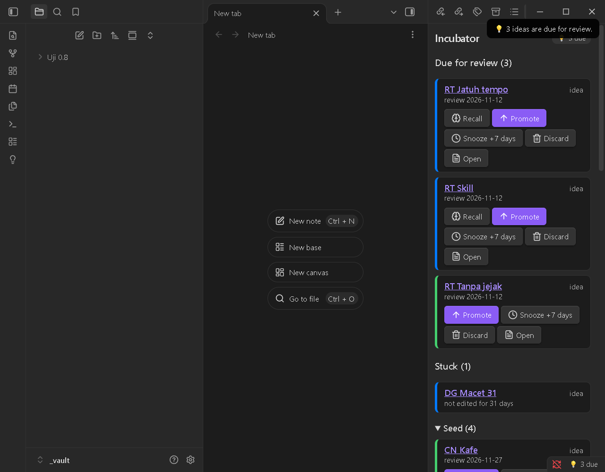
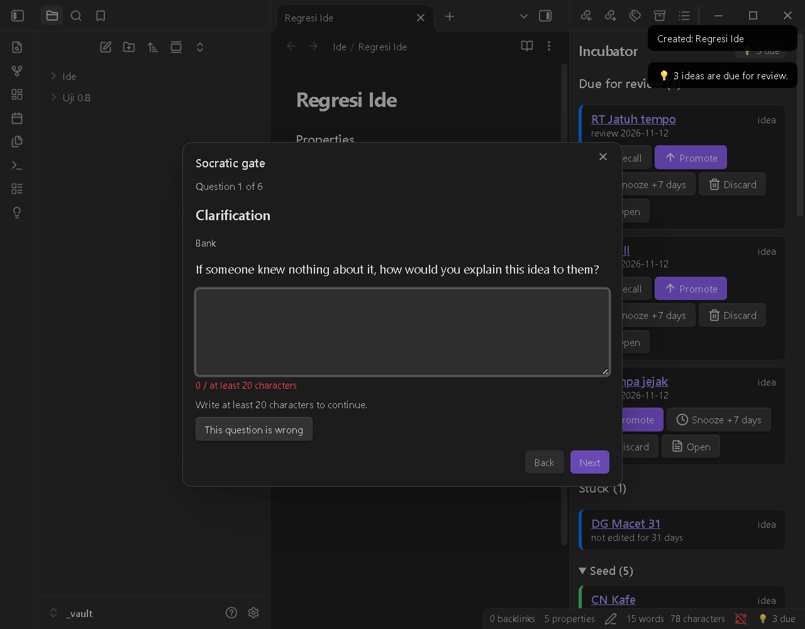
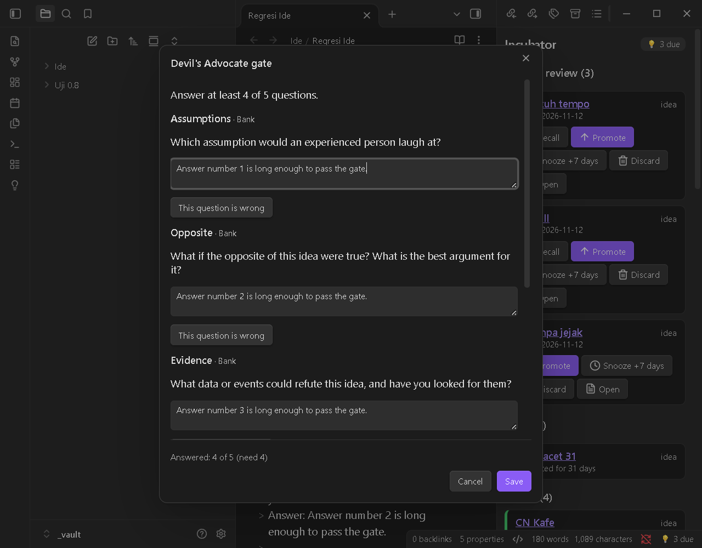
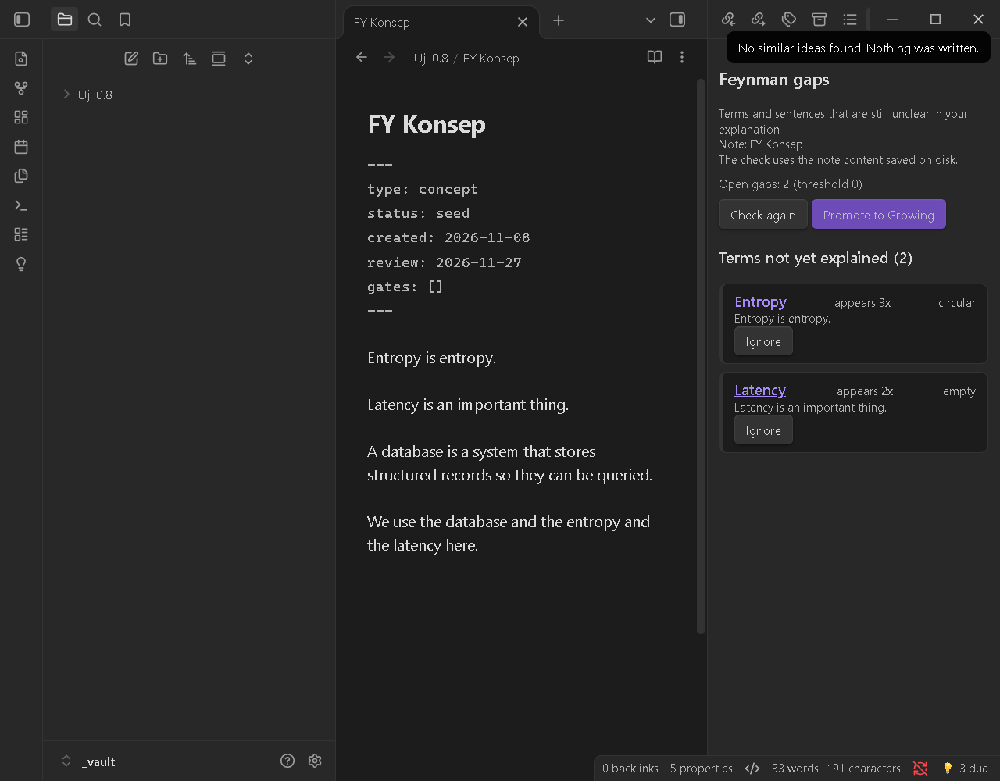
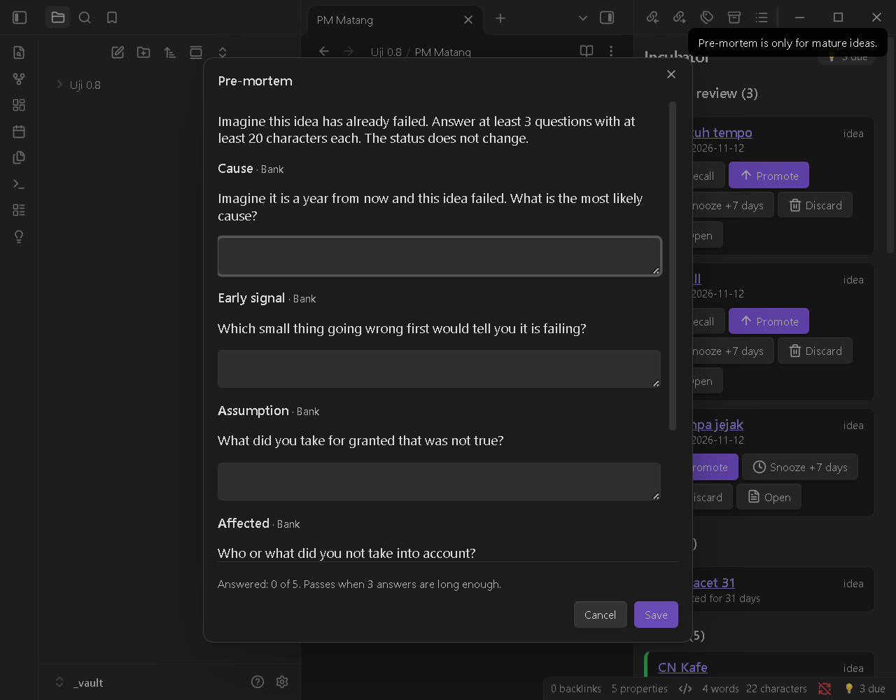
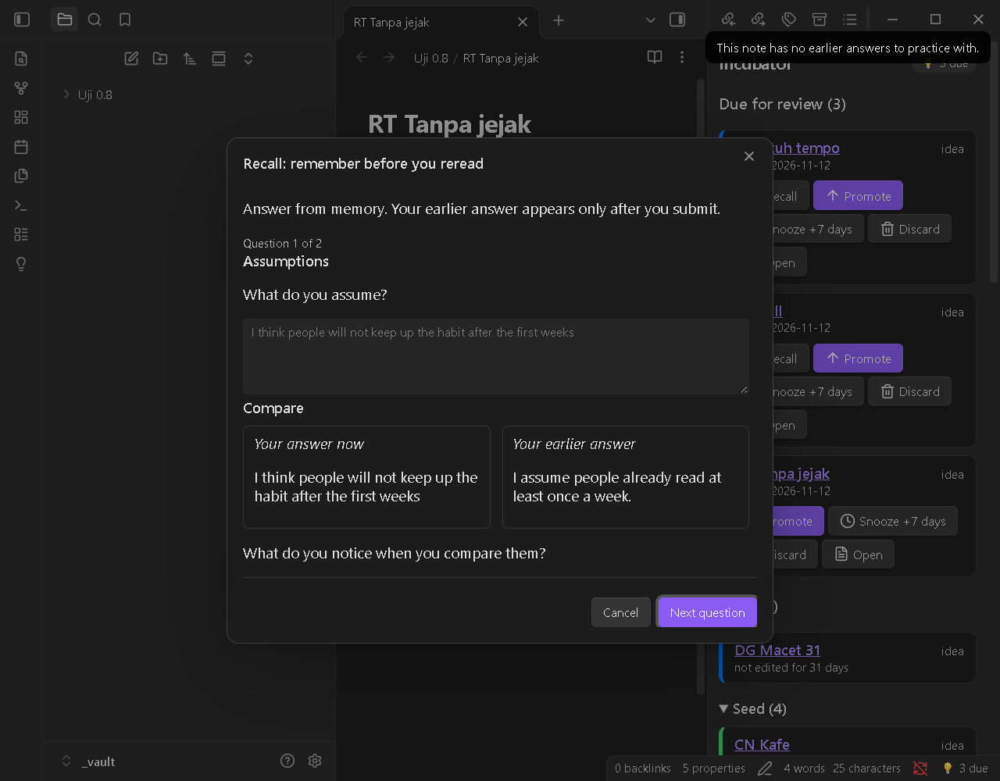
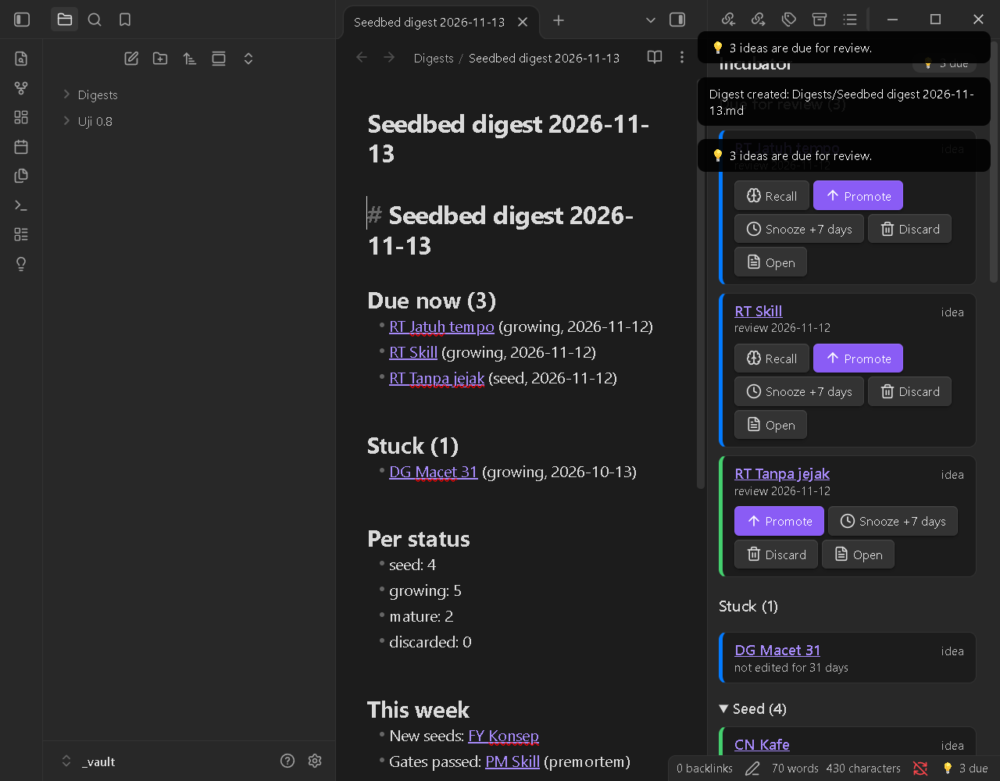
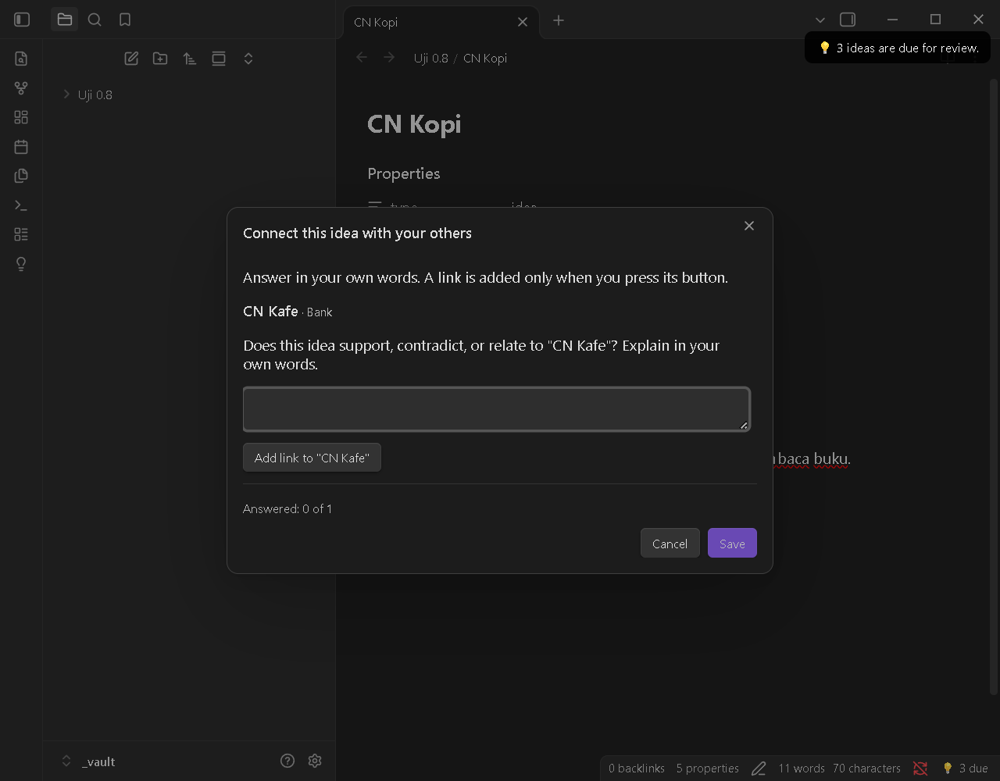

# Seedbed

[English](README.md) · **Bahasa Indonesia**

Plugin Obsidian untuk menginkubasi ide dan menguji pemahaman. Ide hanya naik status setelah lolos "gerbang" berpikir: **Socratic**, **Devil's Advocate**, dan **Feynman**. AI opsional hanya boleh bertanya, tidak pernah menjawab.

> **Status: v0.8.0 (pra-rilis).** Diuji manual di Obsidian desktop (Windows 11). Belum diuji di mobile. Sebelumnya bernama "Bengkel Ide". Baru di 0.8.0: Pre-mortem, Recall, bagian Macet dan digest mingguan, Connect, serta pemeriksaan Feynman yang lebih ketat. Lihat [Tangkapan layar](#tangkapan-layar).



**Privasi dan jaringan.** Saat fitur AI **mati (bawaan)**, plugin ini tidak melakukan satu pun permintaan jaringan dan tidak menjalankan program apa pun. Semua data berupa frontmatter dan callout Markdown biasa di vault-mu, jadi tetap terbaca tanpa plugin. AI hanya aktif jika kamu menyalakannya dan menyetujui tiap penyedia (lihat [AI opsional](#ai-opsional)).

## Daftar isi
- [Konsep](#konsep)
- [Perintah](#perintah)
- [Tangkapan layar](#tangkapan-layar)
- [Format data](#format-data)
- [Mode Feynman](#mode-feynman)
- [Bank pertanyaan kustom](#bank-pertanyaan-kustom)
- [AI opsional](#ai-opsional)
- [Seedbed Capture (ekstensi browser)](#seedbed-capture-ekstensi-browser), kodenya di [`extension/`](extension/README.id.md)
- [Bahasa](#bahasa)
- [Instalasi](#instalasi)
- [Pengembangan](#pengembangan)
- [Rilis](#rilis)
- [Lisensi](#lisensi)

## Konsep

```
Benih --(Socratic / Feynman)--> Tumbuh --(Devil's Advocate)--> Matang
  \________________ Dibuang (kapan saja) ________________/    Matang --> Tumbuh (buka ulang)
```

| Tipe | benih → tumbuh | tumbuh → matang |
|---|---|---|
| `ide` | Gerbang **Socratic** (6 pertanyaan) | Gerbang **Devil's Advocate** (minimal 4 dari 5 dijawab) |
| `konsep` | Gerbang **Feynman** (tidak ada istilah yang belum dijelaskan) | Devil's Advocate opsional (pengaturan) |

- Setiap gerbang bisa dimatikan di Pengaturan; jika mati, status naik dengan satu klik.
- Setiap status punya tanggal tinjau. Ide yang jatuh tempo muncul lagi di panel Inkubator, jadi tidak terlupakan.

## Perintah

| Perintah (Command Palette) | Fungsi |
|---|---|
| Tangkap ide baru | Buat catatan ide dari template di folder `Ide/` |
| Jadikan catatan ini ide / konsep | Tambah properti Seedbed ke catatan yang sudah ada (tidak pernah menimpa `type`/`status` yang bukan tulisannya) |
| Naikkan status ide ini | Naik satu status; membuka gerbang yang dibutuhkan |
| Tantang ide ini (Devil's Advocate) | 5 pertanyaan penantang untuk catatan apa pun; hasilnya jadi callout |
| Mulai Feynman | Buat catatan `Feynman - <Konsep>` (tipe konsep) di folder `Konsep/` |
| Periksa penjelasan (Feynman) | Cari istilah yang belum dijelaskan dan kalimat yang terlalu panjang |
| Buat templat Seedbed | Tambahkan templat Obsidian "Seedbed Idea" dan "Seedbed Concept" ke folder templat (tidak pernah menimpa) |
| Migrasikan properti Seedbed | Ubah catatan berformat properti lama (0.6 `bengkel-*` atau nama dev `seedbed-*`) ke nama polos (bertanya dulu, menyebut jumlah catatan) |
| Pre-mortem ide ini | Gerbang opsional untuk ide matang: "setahun lagi ide ini gagal, kenapa?" (5 pertanyaan). Menambah `premortem` ke `gates`; status tidak berubah |
| Ingat ulang ide ini (Recall) | Latihan mengingat: jawaban lamamu disembunyikan sampai kamu menjawab lagi, lalu tampil berdampingan. Penilaian dirimu (Ingat / Sebagian / Lupa) menggeser tanggal tinjau |
| Hubungkan ide ini (Connect) | Bertanya bagaimana ide ini berkaitan dengan ide Seedbed lainnya (maks. 10, dicocokkan lewat kata). `[[Tautan]]` hanya ditambah bila kamu menekan tombolnya |
| Buat digest mingguan | Menulis `Seedbed digest YYYY-MM-DD.md` (jatuh tempo, macet, jumlah, minggu ini, satu saran). Tidak pernah menimpa |
| Buka Inkubator | Panel samping: jatuh tempo, lalu **Macet**, lalu per status |

Panel Inkubator punya tombol **Naikkan / Tunda / Buang / Buka**, plus **Buka ulang / Pulihkan**, **Recall** (catatan jatuh tempo yang punya jawaban lama) dan **Pre-mortem** (catatan matang). Bagian **Macet** memuat catatan yang berkasnya tidak diedit lebih dari 30 hari (bisa diatur); edit apa pun, termasuk sinkronisasi, mengeluarkannya dari sana. Di desktop ada penanda "💡 N jatuh tempo" di status bar; di mobile penandanya ada di panel.

## Tangkapan layar

Diambil saat uji manual 0.8.0 (Obsidian 1.15.0, Windows 11, vault uji). Antarmuka di gambar berbahasa Inggris; plugin juga tersedia dalam bahasa Indonesia.

| | |
|---|---|
|  **Gerbang Socratic.** Satu pertanyaan per langkah; jawaban minimal 20 karakter. |  **Gerbang Devil's Advocate.** Lima pertanyaan penantang; minimal 4 dijawab. |
|  **Celah Feynman.** Istilah yang belum dijelaskan, kini termasuk definisi melingkar ("Entropy is entropy") dan kosong. |  **Pre-mortem.** "Setahun lagi gagal, kenapa?" untuk ide matang. Status tidak berubah. |
|  **Recall.** Jawaban lama tersembunyi sampai kamu mengirim jawaban, lalu keduanya tampil berdampingan. Tanpa skor. |  **Digest mingguan.** Jatuh tempo, macet, jumlah per status, minggu ini, dan satu ide untuk diuji. |
|  **Connect.** Kandidat hanya ide Seedbed lain; tautan ditambahkan hanya saat kamu menekan tombolnya. | |
## Format data

Frontmatter adalah sumber kebenaran status. Nama properti **polos, tanpa prefiks, dan berbahasa Inggris**, begitu juga nilainya, untuk semua bahasa UI, supaya query dan template tetap sederhana:

```yaml
---
type: idea            # idea | concept
status: growing       # seed | growing | mature | discarded
created: 2026-11-11   # YYYY-MM-DD
review: 2026-11-25    # YYYY-MM-DD, jatuh tempo berikutnya
gates:                # gerbang yang lolos (socratic | devil | feynman | premortem); nilai tak dikenal dipertahankan
  - socratic
source: https://contoh.com/artikel   # hanya untuk tangkapan dari browser
origin: capture                       # hanya untuk tangkapan dari browser
---
```

**Catatan mana yang milik Seedbed?** Karena nama-nama ini umum, sebuah catatan milik Seedbed **hanya jika `type`-nya `idea` atau `concept`**. Catatan lain, bahkan yang punya `status: done`, `type: book`, atau `created`, diabaikan total: tidak tampil di Inkubator, tidak ditandai tidak valid, dan tidak pernah ditulis. Catatan ber-`type: idea` atau `concept` dengan `status` di luar daftar di atas tampil di bagian **Tidak valid**.

**Nama properti bisa diatur** (Pengaturan → Nama properti), supaya cocok dengan template yang sudah kamu punya, misalnya `kind` menggantikan `type`. Nilainya (`idea`, `seed`, dst.) tetap. Mengubah nama tidak mengganti nama properti di catatan yang sudah ada. `created` dan `review` selalu tanggal `YYYY-MM-DD`, dan `source` serta `created` sengaja sama dengan nama yang lazim dipakai Obsidian Web Clipper.

Jejak berpikir disimpan sebagai callout yang hanya ditambahkan di akhir catatan. Label sumber pertanyaan ikut tercatat:

```markdown
> [!socratic]- Sesi Socratic — 2026-11-12
> **Klarifikasi** · AI · cloud (claude cli)
> Cepat dibanding apa? Dari mana data diambil kalau tidak ada cache?
> Jawaban: Dibanding mengambil dari database.
```

Plugin **tidak pernah menghapus isi catatan**. Ia hanya menambah callout dan mengubah properti miliknya sendiri (nama di Pengaturan).

### Format v2 (0.8.0)

Dipakai bersama [skill agent Seedbed](https://github.com/Finarfin12/seedbed-skill) (`docs/format.md`).

- `gates` boleh berisi nilai selain `socratic`, `devil`, `feynman` (misalnya `premortem`). Pembaca wajib **mempertahankan** nilai tak dikenal saat menulis ulang `gates`. Plugin melakukannya (0.7.0 menghapusnya).
- Callout baru, selalu ditambahkan di akhir catatan:

```markdown
> [!premortem]- Pre-mortem — 2026-11-13
> **Penyebab** · Bank
> Bayangkan setahun lagi ide ini gagal. Apa penyebab yang paling mungkin?
> Jawaban: <katamu>

> [!retrieval]- Retrieval — 2026-11-13
> **Ingat ulang** · Bank · forgot
> <pertanyaan lama>
> Jawaban: <jawaban barumu>
> Jawaban lama: <jawaban lamamu>

> [!connect]- Connect — 2026-11-13
> **Kafe baca** · Bank
> Apakah ide ini mendukung, bertentangan dengan, atau berkaitan dengan "Kafe baca"? Jelaskan dengan kata-katamu.
> Jawaban: <katamu>
```

- Kata opsional setelah label sumber di baris label `[!retrieval]` adalah penilaian dirimu: `remembered`, `partly` atau `forgot` (selalu Inggris agar terbaca mesin). Baris jawaban memakai `Answer:`/`Earlier answer:` (EN) atau `Jawaban:`/`Jawaban lama:` (ID).
- Setelah klik "Tambah tautan", satu baris `Related: [[Judul]]` ditambahkan di akhir catatan (tidak pernah ganda).
- Baris isi yang diawali `[!` ditulis `\[!` supaya tidak menjadi callout baru.
- Catatan digest (`Seedbed digest YYYY-MM-DD.md`) tidak punya `type`, jadi bukan catatan Seedbed.

### Templat

Seedbed bisa membuatkan dua templat Obsidian siap pakai, supaya catatan yang kamu mulai manual ikut terbaca:

- `Seedbed Idea.md` dan `Seedbed Concept.md`, di folder templat-mu: yang diatur di Pengaturan → Templat, kalau tidak ada folder plugin inti *Templates* (dibaca dari `.obsidian/templates.json`), kalau tidak ada `Templates/`.
- Isinya memakai **nama properti-mu** dari Pengaturan → Nama properti dan bahasa plugin. Templat konsep memuat petunjuk Feynman.
- **Tidak ada yang ditulis diam-diam.** Saat plugin pertama kali aktif, ia bertanya sekali: **Buat** atau **Nanti**. Kamu bisa membuatnya kapan saja lewat perintah **Buat templat Seedbed** atau tombol di Pengaturan → Templat.
- **Berkas yang sudah ada tidak pernah ditimpa.** Bila sebuah templat sudah ada, ia dilewati dan Seedbed memberi tahu.

```markdown
---
type: idea
status: seed
created: {{date:YYYY-MM-DD}}
review:
gates: []
---

Tulis idemu di sini. Tak perlu rapi: yang penting tertangkap dulu.
```

(Templat konsep sama, dengan `type: concept`, callout petunjuk Feynman, dan bagian "Penjelasanku".)

**Tanggal terisi sendiri.** Bila sebuah catatan ber-`type: idea` atau `concept` dan `created` atau `review`-nya **kosong** (misalnya baru dibuat dari templat), Seedbed mengisinya: `created` = hari ini dan `review` = hari ini ditambah interval status catatan itu. Hanya properti Seedbed yang kosong yang diisi: yang sudah terisi, catatan yang bukan milik Seedbed, dan properti yang sama sekali tidak ada dibiarkan, dan catatan yang sudah diisi tidak ditulis ulang.

Memakai plugin **Templater**, bukan plugin inti? Pakai sintaks tanggalnya sendiri di salinan templat, misalnya `created: <% tp.date.now("YYYY-MM-DD") %>`; biarkan `review:` kosong. (Di sini hanya diuji dengan plugin inti Templates.)

### Contoh query Dataview

````markdown
```dataview
TABLE review, source
FROM "Ide"
WHERE type = "idea" AND status = "seed"
SORT review ASC
```
````

(Belum dijalankan di repositori ini: Dataview tidak terpasang di test-vault. Bila kamu mengubah nama properti, pakai namamu.)

### Upgrade dari 0.6

0.7.0 mengganti nama properti dan nilainya (callout `[!pemicu]` kini `[!trigger]`):

| 0.6 | 0.7 |
|---|---|
| `bengkel-tipe: ide / konsep` | `type: idea / concept` |
| `bengkel-status: benih / tumbuh / matang / dibuang` | `status: seed / growing / mature / discarded` |
| `bengkel-dibuat` | `created` |
| `bengkel-tinjau` | `review` |
| `bengkel-gerbang` | `gates` (nilai tetap) |
| `bengkel-sumber` | `source` |
| `bengkel-asal` | `origin` |

Tidak ada yang rusak saat upgrade:
- **Catatan lama tetap terbaca** (juga nama `seedbed-*` dari build pengembangan 0.7). Inkubator menampilkan ide yang sama; properti lama dan baru, bahkan campuran dalam satu catatan, dipahami, dan callout `[!pemicu]` lama tetap bergaya.
- **Menulis berarti mengonversi, hanya properti milik Seedbed.** Saat plugin mengubah catatan lama (Naikkan, Tunda, gerbang, dst.), properti lama catatan itu dikonversi dalam edit yang sama. Properti lain tidak disentuh.
- **Konversi sekaligus** lewat perintah **Migrasikan properti Seedbed**. Ia menyebut jumlah catatan yang akan diubah dan bertanya dulu. Ia tidak pernah menimpa: bila sebuah catatan sudah punya properti tujuan dengan nilai lain (misalnya `status: draft` dari template lain), catatan itu **dilewati dan didaftar di hasil**, dan tidak ada yang berubah. Catatan dengan type lama yang bukan idea/concept juga dilewati agar tetap terlihat di Tidak valid. Isi catatan tidak pernah disentuh, dan menjalankannya lagi tidak mengubah apa-apa.
- **Query Dataview atau template milikmu** yang memakai nama `bengkel-*` perlu kamu ganti setelah migrasi.

## Mode Feynman

1. Istilah = judul dan alias semua catatan vault (min. 3 huruf) + daftar jargon dari Pengaturan.
2. Istilah yang **muncul** di penjelasanmu dianggap **sudah dijelaskan** jika ada pola `istilah adalah / yaitu / ialah / artinya / berarti / merupakan` (EN: `is / means / refers to`).
3. Blok kode, kode inline, frontmatter, komentar HTML, tujuan tautan, dan callout plugin tidak dianalisis.
4. Kalimat lebih dari 25 kata ditandai sebagai **saran** (tidak menghalangi gerbang).

Sejak 0.8.0 definisi juga ditandai bila **melingkar** ("entropi adalah entropi") atau **kosong** ("entropi adalah hal penting"): hanya pemeriksaan pola dan kata pengisi, tidak pernah menilai benar/salahnya isi. Isi callout `[!premortem]`, `[!retrieval]`, `[!connect]`, `[!trigger]` dan `[!quote]` tidak dianalisis.

Ini pencocokan pola, bukan pemahaman. False positive pasti ada; pakai tombol **Abaikan** (per catatan) atau atur daftar jargon. Pemeriksaan membaca isi catatan yang **tersimpan di disk**.

## Bank pertanyaan kustom

Isi **Pengaturan → File bank kustom** dengan path file JSON di vault. Boleh sebagian saja; kategori yang kosong memakai bawaan:

```json
{
  "id": { "socratic": { "klarifikasi": ["Pertanyaanku sendiri?"] }, "devil": { "kegagalan": ["..."] } },
  "en": { "socratic": { "bukti": ["..."] } }
}
```

Kategori Socratic: `klarifikasi, asumsi, bukti, sudutPandang, implikasi, pertanyaan`. Devil's Advocate: `asumsi, kebalikan, bukti, lawan, kegagalan`.

## AI opsional

AI dipakai **hanya untuk bertanya**: pertanyaan Socratic dan Devil's Advocate yang mengacu pada isi catatan dan jawabanmu sebelumnya. AI **tidak menjelaskan, tidak menjawab, dan tidak menilai gerbang**. Lolos atau tidaknya gerbang tetap ditentukan aturan pasti (panjang jawaban / jumlah jawaban). Setiap pertanyaan diberi label sumber: `AI · lokal (ollama)`, `AI · cloud (claude cli)`, atau `Bank`.

**Mati secara default.** Aktifkan di Pengaturan → AI (opsional), lalu aktifkan dan setujui tiap penyedia satu per satu. Penyedia dicoba berurutan (bisa diatur). Jika gagal atau timeout, plugin pindah ke penyedia berikutnya, dan terakhir ke bank pertanyaan bawaan.

| Penyedia | Apa yang terjadi | Data keluar dari PC? |
|---|---|---|
| **CLI langganan** (Claude Code) | Menjalankan program `claude` yang sudah kamu login-kan. Hanya desktop. | **Ya** (cloud): isi catatan yang sedang dibuka |
| **Model lokal** (Ollama, LM Studio) | Permintaan ke server di komputermu (`localhost`). Plugin tidak memasang apa pun. | Tidak |
| **API** (kompatibel OpenAI) | Permintaan ke alamat yang kamu isi, dengan API key-mu. | **Ya** (cloud), kecuali alamatnya localhost |

**Yang dikirim:** hanya catatan yang sedang dibuka (dipotong ke batas konteks, default 4.000 karakter), jawaban sebelumnya di sesi itu, dan instruksi plugin. Tidak ada catatan lain dan tidak ada telemetri.

**Keamanan CLI** (hanya jika CLI diaktifkan dan disetujui):
- `claude` dijalankan **tanpa shell** dengan argumen tetap: `-p --tools "" --permission-mode dontAsk --permission-prompts none --no-session-persistence --safe-mode --strict-mcp-config --disable-slash-commands --output-format json`. Semua tool (baca/tulis file, shell, web) **dimatikan**, tidak ada permintaan izin, dan tidak ada sesi yang disimpan.
- Isi catatan dikirim lewat **stdin**, bukan argumen. Folder kerjanya **folder sementara kosong** yang dihapus setelah selesai, bukan vault-mu.
- Ada batas waktu; proses dihentikan paksa jika melewatinya. Keluaran hanya dipakai sebagai teks pertanyaan setelah lolos validator, dan tidak pernah dieksekusi.
- Plugin **tidak pernah membaca file login/token** penyedia mana pun.
- **Codex CLI dan Gemini CLI belum didukung**, karena flag untuk mematikan semua tool belum bisa diverifikasi.
- Prompt injection di dalam catatan tetap mungkin dicoba. Plugin membungkus catatan sebagai data, mematikan semua tool, dan menolak keluaran yang bukan pertanyaan.

**Peringatan API key:** key disimpan di `data.json` sebagai **teks biasa** dan ikut tersinkron bila vault-mu disinkronkan.

**Mode Socratic:**
- *Adaptif* (bawaan): satu pertanyaan per langkah, memakai jawabanmu sebelumnya. Pertanyaan berikutnya disiapkan di latar belakang saat kamu berhenti mengetik.
- *Satu tarikan*: 6 pertanyaan dibuat sekaligus di awal.

**Belajar aktif:** tombol Lanjut aktif hanya jika jawabanmu cukup panjang, dan tidak ada tombol "lihat jawaban". **Beri petunjuk** (maks. 2 per pertanyaan) memberi arah berpikir, bukan jawaban. **Pertanyaan ini keliru** menandai pertanyaan, dan tandanya tercatat di callout.

**Kuota langganan:** tiap pertanyaan Socratic adaptif = 1 panggilan; Devil's Advocate = 1 panggilan untuk 5 pertanyaan; tiap petunjuk = 1 panggilan. Pengaturan menampilkan jumlah panggilan sesi ini. Periksa syarat layanan tiap penyedia sebelum memakainya.

## Seedbed Capture (ekstensi browser)

Ide yang muncul saat browsing sering hilang karena tidak sempat dicatat. **Seedbed Capture** adalah ekstensi Chrome pendamping yang menanam ide itu langsung ke Inkubator.

**Cara kerja**
1. Blok teks di halaman web, klik kanan, lalu pilih **Simpan sebagai benih** (atau tekan `Alt+Shift+S`).
2. Jendela kecil menampilkan kutipan, halaman sumber, dan **satu pertanyaan pemicu**, misalnya "Bagian mana yang menurutmu belum tentu benar?". Kamu bisa mengganti pertanyaannya, menulis jawaban satu kalimat, atau membiarkannya kosong.
3. Klik **Simpan** (`Ctrl+Enter`). Ekstensi membuka link `obsidian://seedbed-capture`, lalu Seedbed memeriksanya dan membuat catatan `benih` di folder Ide.

**Bukan web clipper.** Clipper menyimpan apa yang kamu baca. Seedbed Capture menyimpan apa yang kamu *pikirkan* tentang bacaan itu: kutipan pendek, pertanyaan pemicu, dan jawabanmu, yang langsung masuk alur benih → tumbuh → matang.

**Catatan yang dibuat**

```markdown
---
type: idea
status: seed
created: 2026-11-12
review: 2026-11-19
source: https://contoh.com/artikel
origin: capture
---
> [!quote] Kutipan — Judul Halaman
> teks yang diblok…
> — [Judul Halaman](https://contoh.com/artikel)

> [!trigger] Pertanyaan pemicu
> Bagian mana yang menurutmu belum tentu benar?
> Jawaban: …
```

**Menahan tumpukan.** Karena menangkap itu mudah, ide juga mudah menumpuk. Ekstensi memberi peringatan setelah 5 benih sehari (bisa diatur), dan setiap kali tersimpan Seedbed menampilkan "Benih tersimpan. N benih belum ditinjau."

**Keamanan**
- Situs mana pun bisa mencoba membuka link `obsidian://`, jadi Seedbed bertanya **"Simpan tangkapan sebagai benih?"** sebelum menyimpan (aktif secara bawaan; Pengaturan → Tangkapan dari ekstensi).
- Link tangkapan hanya bisa membuat **catatan benih baru yang sudah divalidasi**. Tidak pernah membaca, menimpa, atau menghapus catatan.
- Semua parameter divalidasi dan di-escape: URL sumber hanya `http`/`https`, nama file aman, ada batas panjang, dan teks halaman tidak bisa menyisipkan frontmatter atau callout tambahan.
- Maksimal 1 tangkapan menunggu konfirmasi, dan ada batas jumlah per menit.

**Pengaturan di Seedbed:** konfirmasi setiap tangkapan (aktif), buka catatan setelah disimpan (mati), batas karakter kutipan.

**Fakta ekstensi:** Manifest V3, tanpa server, tanpa akun, tanpa akses jaringan, tanpa telemetri. Kutipan dipotong ke 1.000 karakter secara bawaan. Tanpa Seedbed, mode cadangan membuat catatan biasa lewat `obsidian://new` milik Obsidian. Cara pasang dan alasan tiap izin ada di README ekstensi (`seedbed-capture/README.id.md`).

**Sudah diuji:** Windows 11 + Chrome di Wikipedia, MDN, dan paulgraham.com; waktu dari Simpan sampai catatan muncul 0,26–0,34 detik. Browser dan OS lain belum diuji.

## Agent skill

Gerbang berpikir Seedbed juga tersedia sebagai Agent Skill gratis (MIT) untuk agent AI seperti Claude Code, di repositori tersendiri: [Finarfin12/seedbed-skill](https://github.com/Finarfin12/seedbed-skill). Formatnya sama dengan plugin ini, jadi catatan dari skill muncul di Inkubator.

## Bahasa

UI dan bank pertanyaan tersedia dalam Bahasa Indonesia dan English (Pengaturan → Bahasa). Nama perintah di Command Palette baru berganti setelah plugin dimuat ulang.

## Instalasi

Belum tersedia di Community Plugins. Pasang manual:

1. Unduh `main.js`, `manifest.json`, dan `styles.css` dari halaman Releases.
2. Salin ke `<vault>/.obsidian/plugins/seedbed/`.
3. Aktifkan di **Settings → Community plugins**.

## Pengembangan

```bash
npm install
npm test                    # Vitest: logika domain (tanpa Obsidian)
npm run build               # tsc + esbuild -> main.js
npm run dev                 # esbuild watch
npm run test:live           # uji sungguhan dengan claude asli (memakai kuota, maks. 3 panggilan)
npm run check-integrity     # bandingkan test-vault dengan snapshot
npm run gen-test-vault      # buat test-vault/ (±22 catatan contoh)
npm run install-test-vault  # salin build ke test-vault/.obsidian/plugins/seedbed
```

Buka folder `test-vault/` sebagai vault di Obsidian (**Open folder as vault**), lalu aktifkan plugin. Jangan pakai vault utama untuk uji.

Struktur repositori:
- root repositori: plugin Obsidian (`manifest.json` harus di sini untuk Obsidian dan workflow rilis)
- [`extension/`](extension/README.id.md): ekstensi Chrome **Seedbed Capture**, proyek terpisah dengan `package.json` dan tes sendiri (`cd extension && npm ci && npm test && npm run build`); bukan bagian rilis plugin

Struktur plugin:
- `src/domain`: logika murni, tanpa `obsidian`
- `src/adapter`: vault, frontmatter, cache, penyedia AI
- `src/ui`: panel, modal, pengaturan
- `src/i18n`: teks ID/EN
- `tests/`: unit dan integrasi

## Rilis

1. Isi `author` di `manifest.json` dan nama di `LICENSE`.
2. Naikkan versi: `npm version patch` (atau `minor`/`major`). Skrip `version` memperbarui `manifest.json` dan `versions.json`.
3. `git push --follow-tags`. Workflow `.github/workflows/release.yml` menguji, membangun, lalu membuat **draft release**. Tag harus sama persis dengan `version` (tanpa awalan `v`).
4. Periksa draft di GitHub, lalu publikasikan.
5. Pertama kali saja: ajukan PR ke `obsidianmd/obsidian-releases`. Baca ulang pedoman terbaru, karena plugin ini menjalankan program dan memakai jaringan bila AI dinyalakan.

## Lisensi

[MIT](LICENSE), hak cipta (c) 2026 Finarfin12.
