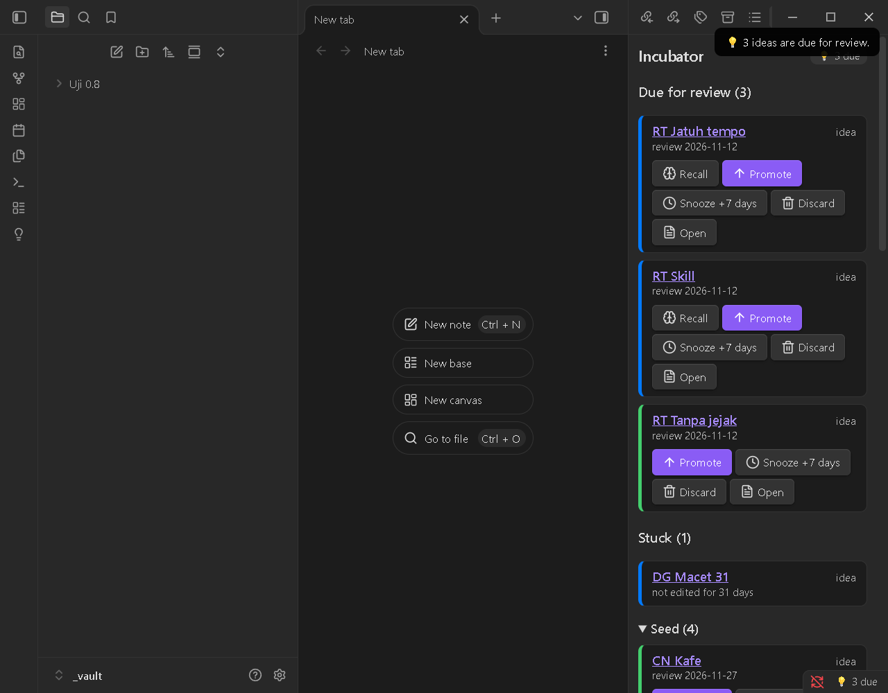
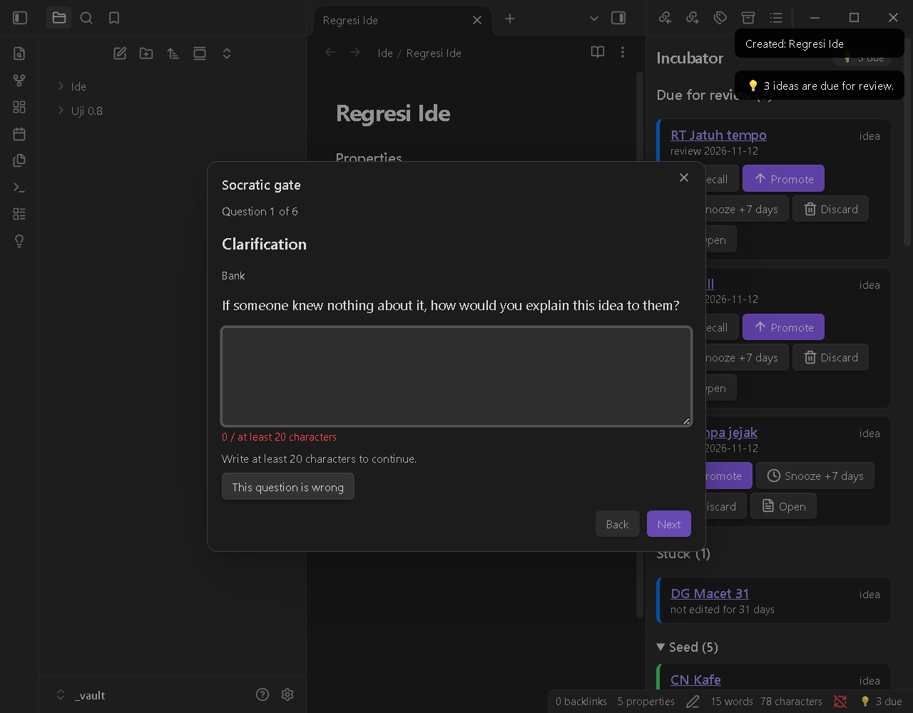
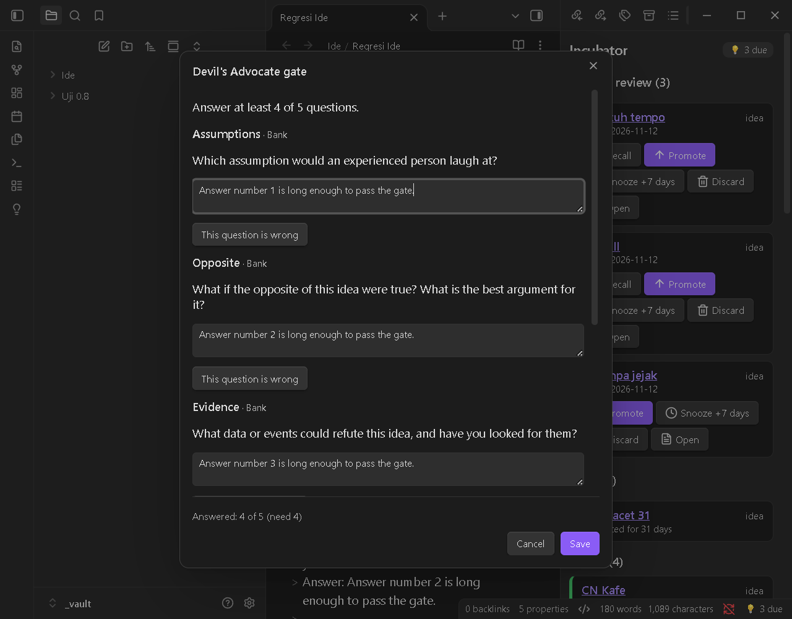
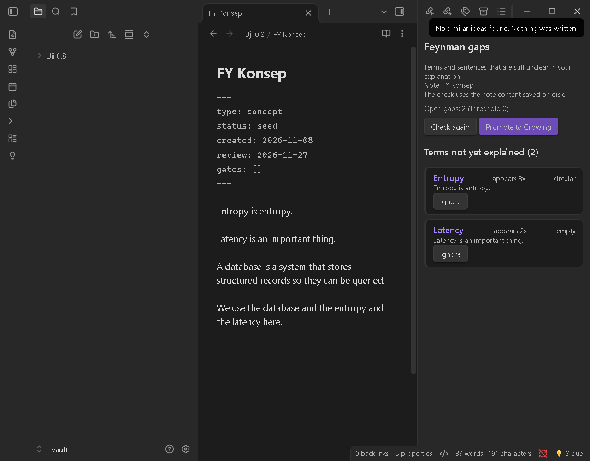
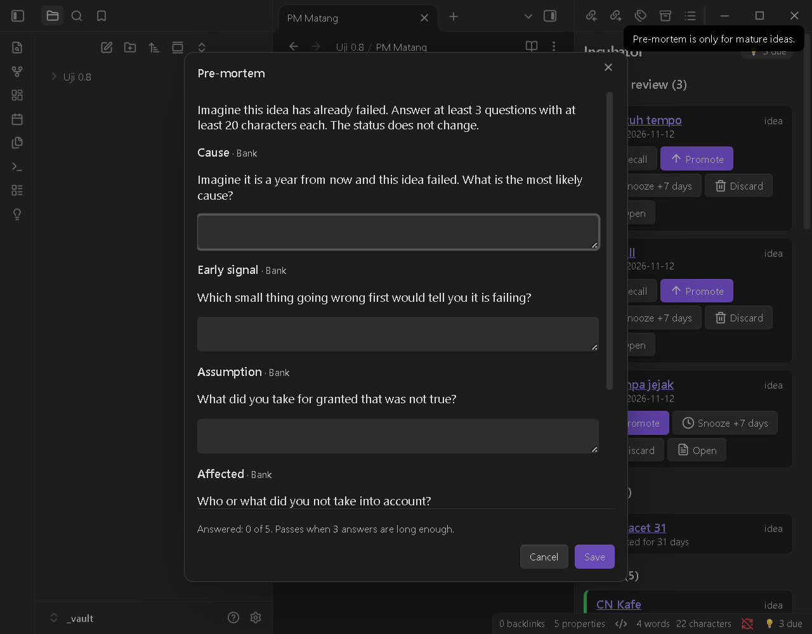
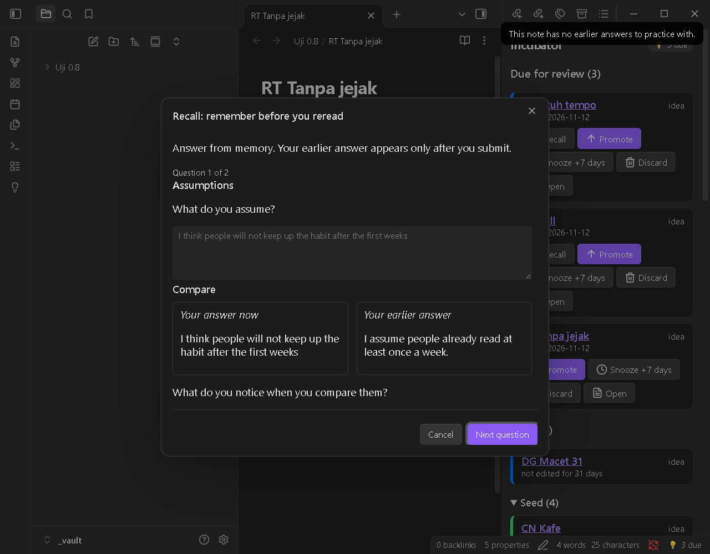
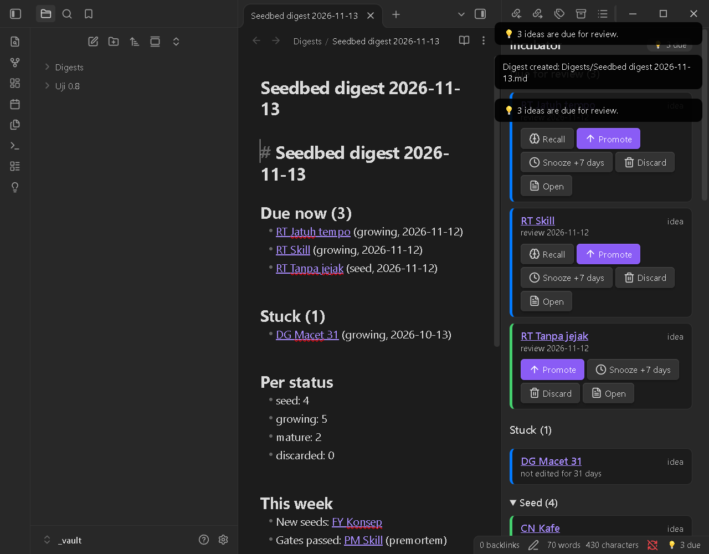
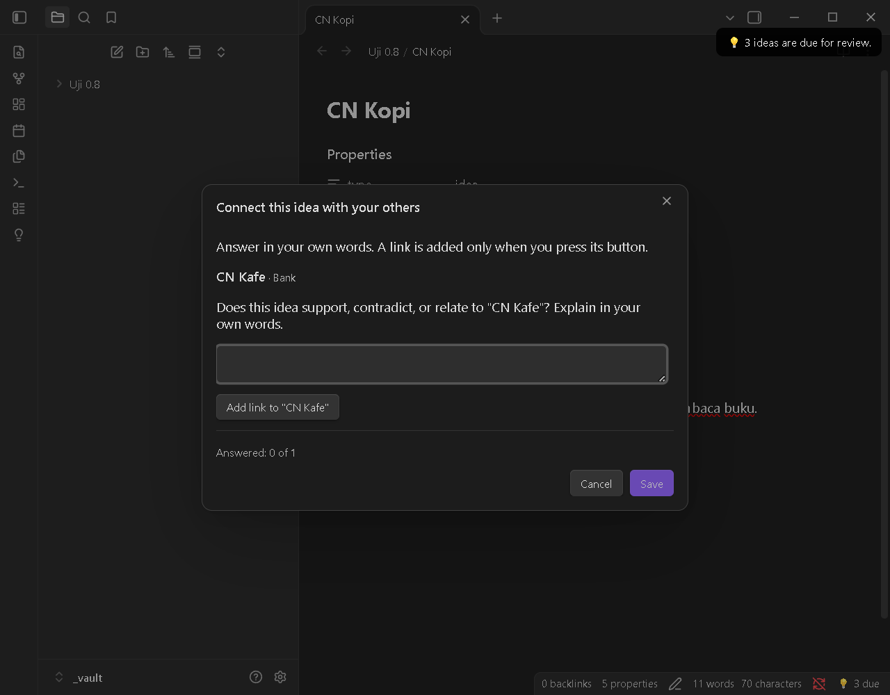

# Seedbed

**English** · [Bahasa Indonesia](README.id.md)

An Obsidian plugin for incubating ideas and testing your understanding. An idea only moves up a stage after it passes a thinking "gate": **Socratic**, **Devil's Advocate**, or **Feynman**. The optional AI is only allowed to ask questions, never to answer them.

> **Status: v0.8.0 (pre-release).** Manually tested on Obsidian desktop (Windows 11). Not yet tested on mobile. New in 0.8.0: Pre-mortem, Recall, Stuck section and weekly digest, Connect, and a stricter Feynman check. See [Screenshots](#screenshots).



**Privacy and network.** With AI **off (the default)**, the plugin makes no network requests and runs no external programs. All data is plain Markdown frontmatter and callouts in your vault, so it stays readable without the plugin. AI only runs after you turn it on and approve each provider (see [Optional AI](#optional-ai)).

## Contents
- [Concept](#concept)
- [Commands](#commands)
- [Screenshots](#screenshots)
- [Data format](#data-format)
- [Feynman mode](#feynman-mode)
- [Custom question bank](#custom-question-bank)
- [Optional AI](#optional-ai)
- [Seedbed Capture (browser extension)](#seedbed-capture-browser-extension), source in [`extension/`](extension/README.md)
- [Language](#language)
- [Installation](#installation)
- [Development](#development)
- [Releasing](#releasing)
- [License](#license)

## Concept

```
Seed --(Socratic / Feynman)--> Growing --(Devil's Advocate)--> Mature
  \_______________ Discarded (any time) _______________/     Mature --> Growing (reopen)
```

| Type | seed → growing | growing → mature |
|---|---|---|
| idea (`ide`) | **Socratic** gate (6 questions) | **Devil's Advocate** gate (at least 4 of 5 answered) |
| concept (`konsep`) | **Feynman** gate (no unexplained terms) | Devil's Advocate optional (setting) |

- Every gate can be switched off in Settings; then a stage change takes one click.
- Every stage has a review date. Due ideas show up again in the Incubator panel, so nothing gets forgotten.

## Commands

| Command (Command Palette) | What it does |
|---|---|
| Capture new idea | Create an idea note from a template in the `Ide/` folder |
| Make this note an idea / a concept | Add the Seedbed properties to an existing note (never overwrites a `type`/`status` it did not write) |
| Promote this idea | Move up one stage; opens the required gate |
| Challenge this idea (Devil's Advocate) | 5 challenging questions on any note; answers are saved as a callout |
| Start Feynman | Create a `Feynman - <Concept>` note (type concept) in the `Konsep/` folder |
| Check explanation (Feynman) | Find unexplained terms and overly long sentences |
| Create Seedbed templates | Add the "Seedbed Idea" and "Seedbed Concept" Obsidian templates to your templates folder (never overwrites) |
| Migrate Seedbed properties | Convert notes that still use an old property format (0.6 `bengkel-*` or the `seedbed-*` dev names) to the plain names (asks first, shows how many notes) |
| Pre-mortem this idea | Optional gate for a mature idea: "it failed a year from now, why?" (5 questions). Adds `premortem` to `gates`; the status never changes |
| Recall this idea | Practice remembering: your earlier answers are hidden until you answer again, then shown side by side. Your own rating (Remembered / Partly / Forgot) moves the review date |
| Connect this idea | Asks how this idea relates to your other Seedbed ideas (up to 10, matched by words). A `[[link]]` is added only when you press its button |
| Create weekly digest | Writes `Seedbed digest YYYY-MM-DD.md` (due, stuck, counts, this week, one suggestion). Never overwrites |
| Open Incubator | Side panel: due items first, then **Stuck**, then grouped by stage |
| Open Feynman gaps panel | List of gaps found in the current explanation |

The Incubator panel has **Promote / Snooze / Discard / Open** buttons, plus **Reopen / Restore**, **Recall** (due notes that have earlier answers) and **Pre-mortem** (mature notes). The **Stuck** section lists notes whose file has not been edited for more than 30 days (a setting); any edit, including sync, takes a note out of it. On desktop a "💡 N due" badge appears in the status bar; on mobile the badge is in the panel.

## Screenshots

Taken during the manual tests of 0.8.0 (Obsidian 1.15.0, Windows 11, test vault).

| | |
|---|---|
|  **Socratic gate.** One question at a time; the answer needs at least 20 characters. |  **Devil's Advocate gate.** Five challenging questions; at least 4 must be answered. |
|  **Feynman gaps.** Unexplained terms, now also circular ("Entropy is entropy") and empty definitions. |  **Pre-mortem.** "It failed a year from now, why?" for mature ideas. The status does not change. |
|  **Recall.** The earlier answer stays hidden until you submit, then both are shown side by side. No score. |  **Weekly digest.** Due, stuck, counts, this week, and one idea to test. |
|  **Connect.** Only other Seedbed ideas are candidates; a link is added only when you press its button. | |
## Data format

Frontmatter is the source of truth for status. Property **names are plain, unprefixed, and English**, and so are the values, for every UI language, so queries and templates stay simple:

```yaml
---
type: idea            # idea | concept
status: growing       # seed | growing | mature | discarded
created: 2026-11-11   # YYYY-MM-DD
review: 2026-11-25    # YYYY-MM-DD, next review date
gates:                # gates passed (socratic | devil | feynman | premortem); unknown values are kept
  - socratic
source: https://example.com/article   # only for captures from the browser
origin: capture                         # only for captures from the browser
---
```

**Which notes are Seedbed's?** Because these names are common, a note belongs to Seedbed **only when its `type` is `idea` or `concept`**. Any other note, even one with `status: done`, `type: book`, or `created`, is ignored completely: it never shows in the Incubator, is never marked invalid, and is never written. A note with `type: idea` or `concept` but a `status` outside the list above appears under **Invalid**.

**Property names are configurable** (Settings → Property names), so Seedbed can match templates you already have, for example `kind` instead of `type`. The values (`idea`, `seed`, and so on) stay the same. Changing a name does not rename properties in existing notes. `created` and `review` are always `YYYY-MM-DD` dates, and `source` and `created` deliberately match the names the Obsidian Web Clipper commonly uses.

Your thinking trail is stored as callouts that are only appended to the end of the note, including the source label of each question:

```markdown
> [!socratic]- Socratic session — 2026-11-12
> **Clarification** · AI · cloud (claude cli)
> Faster compared to what? Where does the data come from without a cache?
> Answer: Compared to fetching it from the database.
```

The plugin **never deletes note content**. It only appends callouts and edits its own properties (the names in Settings).

### Format v2 (0.8.0)

Shared with the [Seedbed agent skill](https://github.com/Finarfin12/seedbed-skill) (`docs/format.md`).

- `gates` may hold values other than `socratic`, `devil`, `feynman` (for example `premortem`). Readers must **keep** unknown values when they rewrite `gates`. The plugin does (0.7.0 dropped them).
- New callouts, always appended at the end:

```markdown
> [!premortem]- Pre-mortem — 2026-11-13
> **Cause** · Bank
> Imagine it is a year from now and this idea failed. What is the most likely cause?
> Answer: <your words>

> [!retrieval]- Retrieval — 2026-11-13
> **Recall** · Bank · forgot
> <the earlier question>
> Answer: <your new answer>
> Earlier answer: <your earlier answer>

> [!connect]- Connect — 2026-11-13
> **Kafe baca** · Bank
> Does this idea support, contradict, or relate to "Kafe baca"? Explain in your own words.
> Answer: <your words>
```

- The optional word after the source on the label line of `[!retrieval]` is your own rating: `remembered`, `partly` or `forgot` (always English, so tools can read it).
- After a click on "Add link", one line `Related: [[Title]]` is appended at the end of the note (never duplicated).
- A line of content that starts with `[!` is written as `\[!` so it cannot become a new callout.
- A digest note (`Seedbed digest YYYY-MM-DD.md`) has no `type`, so it is not a Seedbed note.

### Templates

Seedbed can create two ready-to-use Obsidian templates for you, so notes you start by hand are picked up too:

- `Seedbed Idea.md` and `Seedbed Concept.md`, in your templates folder: the one set in Settings → Templates, otherwise the folder of the core *Templates* plugin (read from `.obsidian/templates.json`), otherwise `Templates/`.
- They use **your property names** from Settings → Property names and the plugin language. The concept template includes the Feynman hints.
- **Nothing is written silently.** The first time the plugin runs, it asks once: **Create** or **Later**. You can create them any time with the command **Create Seedbed templates** or the button in Settings → Templates.
- **Existing files are never overwritten.** If a template already exists, it is skipped and Seedbed tells you.

```markdown
---
type: idea
status: seed
created: {{date:YYYY-MM-DD}}
review:
gates: []
---

Write your idea here. It does not need to be tidy: capturing it comes first.
```

(The concept template is the same with `type: concept` and the Feynman hint callout and "My explanation" section.)

**Dates fill themselves in.** When a note has `type: idea` or `concept` and its `created` or `review` is **empty** (for example a note you just made from a template), Seedbed fills it in: `created` = today and `review` = today plus the interval of the note's status. It only fills empty Seedbed properties: anything already filled, notes that are not Seedbed's, and properties that are missing altogether are left alone, and it never rewrites a note it has already filled.

Using the **Templater** plugin instead of the core one? Use its own date syntax in a copy of the template, for example `created: <% tp.date.now("YYYY-MM-DD") %>`; keep `review:` empty. (Tested here with the core Templates plugin only.)

### Example Dataview query

````markdown
```dataview
TABLE review, source
FROM "Ide"
WHERE type = "idea" AND status = "seed"
SORT review ASC
```
````

(Not run in this repository: Dataview is not installed in the test vault. If you changed the property names, use yours.)

### Upgrading from 0.6

0.7.0 renamed the properties and their values (the `[!pemicu]` callout is now `[!trigger]`):

| 0.6 | 0.7 |
|---|---|
| `bengkel-tipe: ide / konsep` | `type: idea / concept` |
| `bengkel-status: benih / tumbuh / matang / dibuang` | `status: seed / growing / mature / discarded` |
| `bengkel-dibuat` | `created` |
| `bengkel-tinjau` | `review` |
| `bengkel-gerbang` | `gates` (values unchanged) |
| `bengkel-sumber` | `source` |
| `bengkel-asal` | `origin` |

Nothing breaks when you upgrade:
- **Old notes are still read** (also the `seedbed-*` names from 0.7 development builds). The Incubator shows the same ideas; old and new properties, even mixed in one note, are understood, and old `[!pemicu]` callouts keep their style.
- **Writing converts, only Seedbed's own properties.** When the plugin changes an old note (Promote, Snooze, a gate, and so on), it converts that note's old properties in the same edit. Other properties are untouched.
- **Convert everything at once** with the command **Migrate Seedbed properties**. It tells you how many notes it will change and asks first. It never overwrites: if a note already has the target property with a different value (for example `status: draft` from another template), that note is **skipped and listed in the result**, and nothing in it changes. Notes whose old type is not idea/concept are skipped too, so they stay visible under Invalid. Note content is never touched, and running it again does nothing.
- **Your own Dataview queries or templates** that use `bengkel-*` names need updating after you migrate.

## Feynman mode

1. Terms = titles and aliases of all vault notes (min. 3 letters) + your jargon list from Settings.
2. A term that **appears** in your explanation counts as **explained** when it matches a definition pattern: `term is / means / refers to` (Indonesian: `adalah / yaitu / ialah / artinya / berarti / merupakan`).
3. Code blocks, inline code, frontmatter, HTML comments, link targets, and the plugin's own callouts are skipped.
4. Sentences longer than 25 words are flagged as **suggestions** (they don't block the gate).

Since 0.8.0 a definition is also flagged when it is **circular** ("entropy is entropy") or **empty** ("entropy is an important thing"): pattern and filler-word checks only, never a judgement of whether the explanation is true. Text in `[!premortem]`, `[!retrieval]`, `[!connect]`, `[!trigger]` and `[!quote]` callouts is not analysed.

This is pattern matching, not understanding. Expect false positives; use **Ignore** (per note) or tune the jargon list. The check reads the note as **saved on disk**.

## Custom question bank

Set **Settings → Custom bank file** to the path of a JSON file in your vault. Partial files are fine; empty categories fall back to the built-in bank:

```json
{
  "en": { "socratic": { "bukti": ["What is your own question?"] }, "devil": { "kegagalan": ["..."] } },
  "id": { "socratic": { "klarifikasi": ["..."] } }
}
```

Socratic categories: `klarifikasi` (clarification), `asumsi` (assumptions), `bukti` (evidence), `sudutPandang` (viewpoints), `implikasi` (implications), `pertanyaan` (the question itself). Devil's Advocate categories: `asumsi` (assumptions), `kebalikan` (opposite), `bukti` (evidence), `lawan` (opponents), `kegagalan` (failure).

## Optional AI

AI is used **only to ask questions**: Socratic and Devil's Advocate questions that refer to your note and your previous answers. AI **does not explain, does not answer, and does not grade the gates**. Passing a gate is still decided by fixed rules (answer length / number of answers). Every question carries a source label: `AI · local (ollama)`, `AI · cloud (claude cli)`, or `Bank`.

**Off by default.** Turn it on in Settings → AI (optional), then enable and approve each provider one by one. Providers are tried in order (configurable). If one fails or times out, the plugin moves to the next one, and finally to the built-in question bank.

| Provider | What happens | Does data leave your computer? |
|---|---|---|
| **Subscription CLI** (Claude Code) | Runs the `claude` program you are already signed in to. Desktop only. | **Yes** (cloud): the open note |
| **Local model** (Ollama, LM Studio) | Requests to a server on your machine (`localhost`). The plugin installs nothing. | No |
| **API** (OpenAI-compatible) | Requests to the URL you enter, with your API key. | **Yes** (cloud), unless the URL is localhost |

**What is sent:** only the open note (trimmed to the context limit, 4,000 characters by default), your earlier answers in that session, and the plugin's instructions. No other notes, no telemetry.

**CLI safety** (only when the CLI is enabled and approved):
- `claude` runs **without a shell** with fixed arguments: `-p --tools "" --permission-mode dontAsk --permission-prompts none --no-session-persistence --safe-mode --strict-mcp-config --disable-slash-commands --output-format json`. All tools (file read/write, shell, web) are **disabled**, no permission prompts appear, and no session is saved.
- The note is passed via **stdin**, never as an argument. The working directory is an **empty temp folder** that is deleted afterwards, not your vault.
- A hard timeout applies; the process is killed if it runs over. Output is only used as question text after it passes a validator, and is never executed.
- The plugin **never reads login or token files** of any provider.
- **Codex CLI and Gemini CLI are not supported yet**, because there is no verified way to disable all of their tools.
- Prompt injection inside a note can still be attempted. The plugin wraps the note as data, disables all tools, and rejects any output that isn't a question.

**API key warning:** the key is stored in `data.json` as **plain text** and syncs with your vault if you sync it.

**Socratic modes:**
- *Adaptive* (default): one question per step, built on your previous answer. The next question is prepared in the background when you stop typing.
- *One shot*: all 6 questions are generated at the start.

**Active learning by design:** Next only unlocks when your answer is long enough, and there is no "show answer" button. **Give a hint** (max. 2 per question) nudges your thinking without giving the answer. **This question is wrong** flags a question, and the flag is saved in the callout.

**Subscription quota:** each adaptive Socratic question = 1 call; Devil's Advocate = 1 call for all 5 questions; each hint = 1 call. Settings shows the call count for the current session. Check each provider's terms of service before use.

## Seedbed Capture (browser extension)

Ideas that come up while browsing get lost because there's no time to write them down. **Seedbed Capture** is a companion Chrome extension that plants them straight into your Incubator.

**How it works**
1. Select text on any web page, right-click, and choose **Save as seed** (or press `Alt+Shift+S`).
2. A small window shows the quote, the source page, and **one trigger question**, such as "Which part do you think isn't necessarily true?" You can swap the question, write a one-sentence answer, or leave it empty.
3. Click **Save** (`Ctrl+Enter`). The extension opens an `obsidian://seedbed-capture` link; Seedbed checks it and creates a `seed` note in your Ideas folder.

**Not a web clipper.** A clipper keeps what you read. Seedbed Capture keeps what you *think* about what you read: a short quote, a trigger question, and your answer, already inside the seed → growing → mature flow.

**The note it creates**

```markdown
---
type: idea
status: seed
created: 2026-11-12
review: 2026-11-19
source: https://example.com/article
origin: capture
---
> [!quote] Quote — Page title
> the selected text…
> — [Page title](https://example.com/article)

> [!trigger] Trigger question
> Which part do you think isn't necessarily true?
> Answer: …
```

**Keeping the pile small.** Capturing is easy, so it's easy to hoard. The extension warns you after 5 seeds a day (adjustable), and after each save Seedbed shows "Seed saved. N seeds not reviewed yet."

**Safety**
- Any website can try to open an `obsidian://` link, so Seedbed asks **"Save this capture as a seed?"** before saving (on by default; Settings → Captures from the extension).
- A capture link can only create a **new, validated seed note**. It never reads, overwrites, or deletes notes.
- All parameters are validated and escaped: only `http`/`https` source URLs, safe file names, length limits, and page text that can't inject frontmatter or extra callouts.
- Max. 1 capture waiting for confirmation, plus a per-minute rate limit.

**Settings in Seedbed:** confirm every capture (on), open the note after saving (off), quote character limit.

**Extension facts:** Manifest V3, no server, no account, no network access, no telemetry. Quotes are cut to 1,000 characters by default. Without Seedbed installed, a fallback mode creates a plain note through Obsidian's `obsidian://new`. Installation and permissions are described in the extension's own README (`seedbed-capture/README.md`).

**Tested:** Windows 11 + Chrome on Wikipedia, MDN, and paulgraham.com; capture-to-note time 0.26–0.34 s. Other browsers and operating systems are untested.

## Agent skill

The Seedbed thinking gates are also available as a free (MIT) Agent Skill for AI agents such as Claude Code, in its own repository: [Finarfin12/seedbed-skill](https://github.com/Finarfin12/seedbed-skill). It uses the same note format as this plugin, so notes made by the skill show up in the Incubator.

## Language

The UI and question bank are available in English and Bahasa Indonesia (Settings → Language). Command names in the Command Palette change after the plugin reloads.

## Installation

Not yet available in Community Plugins. To install manually:

1. Download `main.js`, `manifest.json`, and `styles.css` from the Releases page.
2. Copy them to `<vault>/.obsidian/plugins/seedbed/`.
3. Enable the plugin in **Settings → Community plugins**.

## Development

```bash
npm install
npm test                    # Vitest: domain logic (no Obsidian needed)
npm run build               # tsc + esbuild -> main.js
npm run dev                 # esbuild watch
npm run test:live           # real test with the actual claude CLI (uses quota, max. 3 calls)
npm run check-integrity     # compare test-vault against its snapshot
npm run gen-test-vault      # create test-vault/ (~22 sample notes)
npm run install-test-vault  # copy the build into test-vault/.obsidian/plugins/seedbed
```

Open the `test-vault/` folder in Obsidian (**Open folder as vault**) and enable the plugin. Don't test in your main vault.

Repository layout:
- repository root: the Obsidian plugin (`manifest.json` must be here for Obsidian and for the release workflow)
- [`extension/`](extension/README.md): the **Seedbed Capture** Chrome extension, a separate project with its own `package.json` and tests (`cd extension && npm ci && npm test && npm run build`); it is not part of the plugin release

Plugin layout:
- `src/domain`: pure logic, no `obsidian` imports
- `src/adapter`: vault, frontmatter, cache, AI providers
- `src/ui`: panels, modals, settings
- `src/i18n`: English and Indonesian strings
- `tests/`: unit and integration tests

## Releasing

1. Fill in `author` in `manifest.json` and the name in `LICENSE`.
2. Bump the version: `npm version patch` (or `minor`/`major`). The `version` script updates `manifest.json` and `versions.json`.
3. `git push --follow-tags`. The `.github/workflows/release.yml` workflow tests, builds, and creates a **draft release**. The tag must match `version` exactly (no `v` prefix).
4. Review the draft on GitHub, then publish it.
5. First release only: open a PR to `obsidianmd/obsidian-releases`. Re-read the latest guidelines first, because this plugin runs programs and uses the network when AI is on.

## License

[MIT](LICENSE), copyright (c) 2026 Finarfin12.

